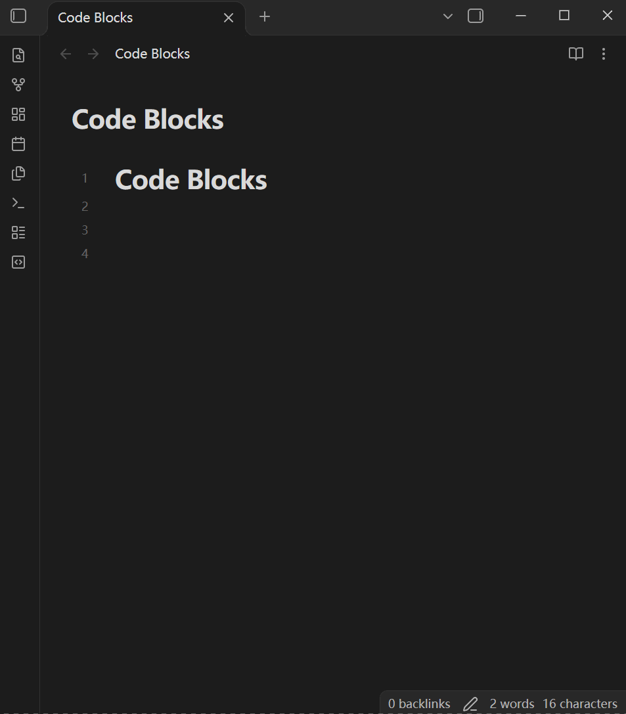
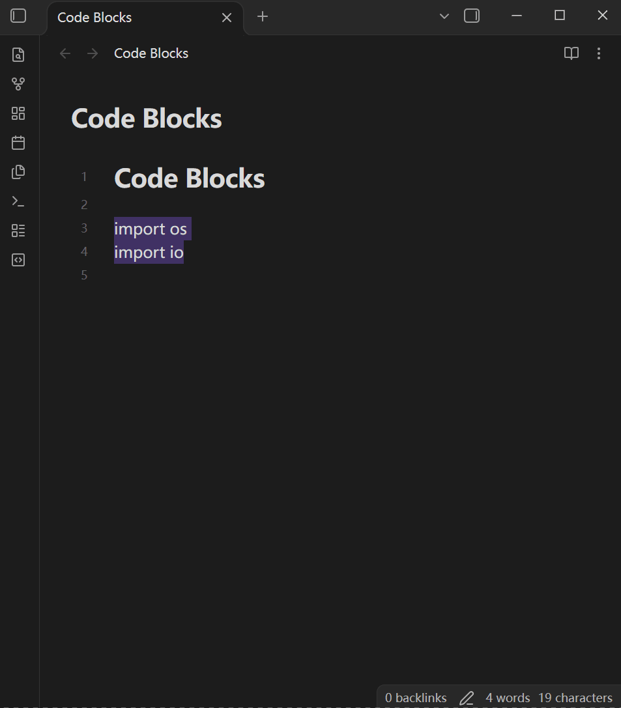

# Code Blocks commands

[English](./README.md) | [简体中文](./README-zh_CN.md) | **繁體中文**

## 介紹

這是一個用於 [Obsidian](https://obsidian.md) 的外掛，提供命令以插入帶有標記的程式碼塊，並支援使用反引號觸發命令。

## 功能

### 使用反引號觸發命令

您可以透過使用反引號來觸發標記選擇選單：

### 插入帶有標記的程式碼塊

您可以使用命令插入帶標記的程式碼塊：

### 其他特性

- 外掛會根據使用習慣對標記列表進行排序。每個標記的使用權重在 30 天未使用後減半，因此最近使用的標記會優先顯示。
- 可選擇優先顯示開頭與輸入內容完全匹配的標記建議，忽略其使用權重。可在外掛設定中啟用「優先顯示開頭匹配」，預設關閉。
- 允許自定義語法高亮標記。其中，對於每個語言：
  - 標記：**必需**，語言的標記。
  - 語言名稱：可選，語言的名稱。
  - 標記標題：可選，對於不是從語言名稱派生出來的標記，可以提供一個相關的標題以方便檢索。
  - 允許在空格建議中使用：可選，允許該標記出現在反引號右側空格之後觸發的標記選擇選單中。僅在外掛設定中啟用「允許在空格處觸發標記選擇選單」後生效。
- 可選擇在標記列表中包含 [Codeblock Customizer](https://github.com/mugiwara85/CodeblockCustomizer) 外掛的參數。若您安裝了該外掛，可在外掛設定中啟用。
- 可選擇將使用記錄單獨儲存在外掛目錄下的 `usage.json`，而不是 `data.json`，以便在同步服務中單獨排除使用記錄。可在外掛設定中啟用「單獨儲存使用記錄」，預設關閉；關閉時記錄會遷回 `data.json` 並刪除該檔案。

## 致謝

- [PrismJS/prism](https://github.com/PrismJS/prism)

## 許可

[MIT](/LICENSE)
